# Audio du Xiaomi 12T Pro (diting) — tout ce qui a été fait

Ce dossier regroupe tout ce qui concerne l'audio du diting sous Arch Linux ARM : les
haut-parleurs (deux amplis Cirrus CS35L41), l'écouteur, les micros (codec WCD938x), l'audio des
appels dans l'ADSP, et la configuration UCM et PipeWire.

> **Ce sont des copies de référence, figées le 2026-10-30.** Les fichiers réellement construits
> et installés restent ceux de `pkgbuilds/` (`linux-diting`, `diting-device`) et de
> royka1/diting-ubuntu au commit `c68ff47db947` (scripts d'appel, UCM, topologie). Après une
> modification, mettez d'abord ces originaux à jour, puis recopiez ici.

## Contenu

| Dossier | Contenu | Original |
|---|---|---|
| `pilote/sound/soc/qcom/` | Pilote machine `sc8280xp.c` et fichiers AudioReach (`qdsp6/`) **après** toute la série de patches (Linux 7.2.10 + diting-ubuntu `c68ff47` + `0903`) | patches `0023`, `0046`, `0047`, `0049`–`0051`, `0086` |
| `pilote/include/dt-bindings/sound/` | `qcom,q6dsp-lpass-ports.h` après le patch `0047` (identifiants d'horloge TDM) | patch `0047` |
| `patches/diting-ubuntu/` | Patches audio de diting-ubuntu | `kernel/patches/` de diting-ubuntu |
| `patches/alarm-diting/` | `0903` : ports et lanes SoundWire séparés pour les deux micros | `pkgbuilds/linux-diting/0903` |
| `scripts/` | `ucm-diting.py`, hook pacman et script CallAudio de ce dépôt | `pkgbuilds/diting-device/` |
| `scripts/diting-ubuntu/` | Démons d'appel, protection des haut-parleurs, audio PD, services et règles udev, **tels qu'installés** (avec les `sed` du PKGBUILD de `diting-device`) | `ubuntu-diting/packages/device-xiaomi-diting/` |
| `scripts/ucm/` | Profil UCM : `HiFi.conf` **tel qu'installé** (après `ucm-diting.py`) et l'original `HiFi.conf.diting-ubuntu` | idem |
| `scripts/topologie/` | Sources m4 de la topologie AudioReach des haut-parleurs (compilées en `XIAOMI-DITING-tplg.bin` par le PKGBUILD de `diting-device`) | `ubuntu-diting/packages/audio-topology/` |

Pas copiés, car ils viennent du téléphone et ne doivent pas être publiés : la topologie des appels
et les modules ADSP (ACDB du vendeur), et la calibration des haut-parleurs (`persist/audio/crus_calr.bin`).
Ils sont fournis par le paquet local `firmware-xiaomi-diting`.

## 1. Matériel

| Élément | Composant | Liaison |
|---|---|---|
| DSP audio | ADSP (LPASS), firmware AudioReach du vendeur | remoteproc `adsp` |
| Haut-parleurs | 2 × Cirrus CS35L41 : 0x40 en bas (droite), 0x42 en haut (gauche) | I2C QUP SE15 à 400 kHz ; audio en TDM tertiaire (`TERTIARY_TDM_RX_0`) |
| Écouteur | Sortie de l'ampli du **haut**, commutée par TLMM 52 (« Top MUX » : Speaker / Earpiece) | — |
| Micros | 2 micros analogiques (AMIC1, AMIC5) sur un codec WCD938x, micbias 2,75 V | SoundWire → macro TX du LPASS → `TX_CODEC_DMA_TX_3` |
| Prise casque | aucune | — |

### Schéma complet de la topologie audio

Chemins actifs : média en lecture (haut-parleurs), média en capture (micros) et appels. Le bus SoundWire RX
(`3210000`, sortie casque du WCD938x) existe mais ne sert pas : il n'y a pas de prise casque.

```mermaid
flowchart LR
    subgraph US["Espace utilisateur"]
        APP["Applications<br/>Plasma, plasma-dialer"]
        PW["PipeWire + WirePlumber<br/>profil UCM HiFi"]
        SINK["Sortie<br/>HiFi__Speaker__sink"]
        SRC["Source stéréo<br/>HiFi__Mic__source<br/>FL = bas, FR = haut"]
        VC["diting-voice-call<br/>+ diting-voice-pcm"]
        CA["diting-callaudio<br/>écouteur / haut-parleur, sourdine"]
        SP["diting-speaker-protection<br/>firmware CSPL + calibration"]
        MM["ModemManager"]
    end

    subgraph DSP["ADSP (LPASS), AudioReach"]
        MM1["MultiMedia1<br/>lecture, hw:0,0"]
        MM2["MultiMedia2<br/>capture, hw:0,1"]
        MM3["MultiMedia3 Voice<br/>appel RX, hostless"]
        MM4["MultiMedia4 Voice<br/>appel TX, hostless"]
        VCPM["VCPM + Fluence ECNS<br/>graphes d'appel du vendeur"]
        TDMRX["TERTIARY_TDM_RX_0"]
        TXDMA["TX_CODEC_DMA_TX_3"]
    end

    subgraph LPASS["LPASS, macro TX"]
        DEC0["DEC0<br/>TX SMIC MUX0 = SWR_MIC0"]
        DEC1["DEC1<br/>TX SMIC MUX1 = SWR_MIC5"]
        AIF["TX_AIF1_CAP"]
        SWRTX["SoundWire TX 33b0000<br/>port 1 : lane 1, gpio2<br/>port 2 : lane 2, gpio14"]
    end

    subgraph WCD["Codec WCD938x"]
        ADC1["ADC1<br/>codec port 1"]
        ADC4["ADC4, ADC4 MUX INP5<br/>codec port 2"]
    end

    subgraph MICS["Micros"]
        AMIC1["AMIC1 : micro du bas<br/>MIC BIAS1"]
        AMIC5["AMIC5 : micro du haut<br/>MIC BIAS4"]
    end

    subgraph AMPS["Amplis CS35L41, TDM tertiaire<br/>horloge de bit inversée"]
        AMPB["B 0x40<br/>canal droit"]
        AMPT["T 0x42<br/>canal gauche"]
    end

    TOPMUX{"Top MUX<br/>TLMM 52"}
    HPB["Haut-parleur du bas"]
    HPT["Haut-parleur du haut"]
    EAR["Écouteur"]

    APP --> PW
    PW --> SINK --> MM1 --> TDMRX
    TDMRX --> AMPB --> HPB
    TDMRX --> AMPT --> TOPMUX
    TOPMUX -- Speaker --> HPT
    TOPMUX -- Earpiece --> EAR

    AMIC1 --> ADC1 --> SWRTX
    AMIC5 --> ADC4 --> SWRTX
    SWRTX --> DEC0 --> AIF
    SWRTX --> DEC1 --> AIF
    AIF --> TXDMA --> MM2 --> SRC
    SRC --> PW

    MM -. "état des appels" .-> VC
    VC -. "routes + ouverture" .-> MM3
    VC -. "routes + ouverture" .-> MM4
    MM3 --> TDMRX
    TXDMA --> MM4
    MM3 <--> VCPM
    MM4 <--> VCPM
    VCPM <-. "voix" .-> MODEM["Modem"]
    CA -. "Top MUX, volumes" .-> TOPMUX
    SP -. "I2C QUP SE15" .-> AMPS
```



| Chemin | Trajet |
|---|---|
| Lecture média | PipeWire → `MultiMedia1` (`hw:0,0`) → `TERTIARY_TDM_RX_0` → CS35L41 B (bas, canal droit) et T (haut, canal gauche) → haut-parleurs ; le « Top MUX » envoie l'ampli du haut vers le haut-parleur du haut. |
| Capture média | AMIC1 → ADC1 → port 1 (lane 1) → `SWR_MIC0` → DEC0 → canal gauche ; AMIC5 → ADC4 → port 2 (lane 2) → `SWR_MIC5` → DEC1 → canal droit ; puis `TX_AIF1_CAP` → `TX_CODEC_DMA_TX_3` → `MultiMedia2` (`hw:0,1`) → source stéréo. |
| Appel | `diting-voice-call` route `MultiMedia3` vers les amplis et `TX_CODEC_DMA_TX_3` vers `MultiMedia4`, puis `diting-voice-pcm` ouvre les deux sessions hostless : la voix passe modem ↔ VCPM ↔ codecs dans l'ADSP, avec la réduction de bruit Fluence sur les deux micros. `diting-callaudio` bascule le « Top MUX » sur l'écouteur ou le haut-parleur. |

## 2. Patches du noyau, dans l'ordre d'application

| Patch | Origine | Rôle |
|---|---|---|
| `0016` | diting-ubuntu | DT : active l'ADSP (firmware vendeur reconditionné en une image). |
| `0022` | diting-ubuntu | DT : les deux CS35L41 (GPIO reset/IRQ, boost interne du vendeur, firmware choisi par l'identifiant « diting » et le préfixe B/T). |
| `0023` | diting-ubuntu | Pilote machine : codecs MI2S en esclaves d'horloge ; horloge de bit votée avant la mise sous tension des codecs (sinon le PLL des CS35L41 ne se verrouille pas). |
| `0024` | diting-ubuntu | DT : carte son des haut-parleurs (LPAIF I2S tertiaire, topologie AudioReach `XIAOMI-DITING`). |
| `0044` | diting-ubuntu | DT : codec WCD938x, macros TX/RX/VA, SoundWire, micros AMIC1 et AMIC5. |
| `0045` | diting-ubuntu | DT : tas distant de l'« audio PD » de l'ADSP (chargement des modules dynamiques comme l'annulation d'écho Fluence). |
| `0046` | diting-ubuntu | AudioReach : graphes d'appel « hostless » du vendeur (VCPM, mailboxes, Fluence ECNS), configuration des modules par la topologie, ouverture hors bande des gros graphes, fichier debugfs `q6apm_raw`. |
| `0047` | diting-ubuntu | Ports TDM utilisés comme de l'I2S (le vendeur câble les amplis en TDM), horloges de bit TDM, prise en charge par le pilote machine. |
| `0048` | diting-ubuntu | DT : haut-parleurs en TDM tertiaire, **horloge de bit inversée** comme sous Android (non inversée : souffle fort et signal faible). |
| `0049` | diting-ubuntu | q6apm : ouvrir les liens du graphe d'appel dès l'ouverture du graphe du périphérique de sortie. |
| `0050` | diting-ubuntu | Topologie : un conteneur DSP partagé entre plusieurs sous-graphes (le rendu de l'appel vit dans le conteneur du haut-parleur). |
| `0051` | diting-ubuntu | Pilote machine : garder les **2 canaux micro** (sinon mono, et la réduction de bruit bi-micro de l'appel reçoit la mauvaise entrée). |
| `0052` | diting-ubuntu | DT : commutateur écouteur / haut-parleur du haut (TLMM 52, `simple-audio-mux` « Top MUX »). |
| `0053` | diting-ubuntu | DT : I2C des amplis à 400 kHz (le firmware de protection, écrit par blocs de 20 Ko, dépassait le délai à 100 kHz). |
| `0086` | diting-ubuntu | Pilote machine : pour une paire stéréo, RX1 = son canal, RX2 = l'autre (sinon le firmware de protection rendait muet l'ampli du bas). |
| `0903` | ce dépôt | DT : les ports 1 et 2 du codec partageaient le port maître SoundWire 1, donc ADC1 et ADC4 émettaient dans la même case : **bruit blanc**. Le port 2 passe sur le port maître 2 ; l'ADC4 arrive alors sur `SWR_MIC5`, et la route DAPM suit. Lanes et décalages d'Android : port 1 sur la lane 1 (`gpio2`), port 2 sur la lane 2 (`gpio14`), décalage 0 tous les deux. Les deux ports sur la lane 1 (décalages 0 et 1) soufflaient encore à certains démarrages. |

Autres patches utiles à l'audio mais pas propres à lui : `0029` (modem), `0085` (fastrpc : requêtes DSP
gardées pendant la veille), `0910` de ce dépôt (interruptions SMP2P du SLPI).

## 3. Espace utilisateur

### Profil UCM et PipeWire — `scripts/ucm-diting.py`
Il corrige le `HiFi.conf` de diting-ubuntu à la construction de `diting-device` (testé le 2026-10-26) :
- **micro activé avec le profil** (`MultiMedia2 Mixer TX_CODEC_DMA_TX_3`). Sinon, PipeWire 1.6 ne peut pas ouvrir
  la capture et rejette tout le profil HiFi ;
- **stéréo** : la protection CS35L41 mélangeait les deux canaux, et les deux amplis les recevaient dans un ordre
  inverse. `ASPRX1` sur les deux entrées des deux amplis donne la gauche en haut et la droite en bas ;
- **micro du haut (ADC4) sur `SWR_MIC5`**, conséquence du patch `0903` ;
- **gain des décimateurs +24 dB** (108 au lieu de 84) : voix vers -42 dBFS, pics vers -18 dBFS sans écrêtage.

Les mêmes changements `SWR_MIC5` et `108` sont appliqués par `sed` aux scripts d'appel (PKGBUILD de `diting-device`).

La source stéréo porte le micro du bas à gauche (ADC1) et le micro du haut à droite (ADC4). Les deux ADC restent
allumés ensemble : l'ADC4 seul bloque la capture (cause non trouvée, testé le 2026-10-31). Des devices UCM
séparés par micro, sur le même PCM de capture, feraient des profils combinés (« Speaker + micro »). Après une
modification de `HiFi.conf`, redémarrer PipeWire : il ne relit l'UCM qu'à son démarrage.

### Audio des appels (diting-ubuntu)
L'audio des appels tourne entièrement dans l'ADSP (modem ↔ VCPM ↔ codecs), comme le PAL d'Android.

| Fichier | Rôle |
|---|---|
| `diting-voice-call` + `.service` | Suit les appels de ModemManager (D-Bus). Pendant un appel : route RX (MultiMedia3) vers les haut-parleurs et les micros (TX codec DMA 3) vers TX (MultiMedia4), puis lance `diting-voice-pcm`. Un appel entrant sonne par le chemin média jusqu'au décroché. |
| `diting-voice-pcm` | Garde ouvertes les deux sessions « hostless » (MultiMedia3 Voice, MultiMedia4 Voice), ce qui démarre les graphes par DPCM. |
| `diting-callaudio` + `org.mobian_project.CallAudio.service` | Remplace callaudiod (interface D-Bus utilisée par plasma-dialer) : écouteur / haut-parleur par « Top MUX », sourdine ; les touches de volume règlent le niveau des amplis pendant l'appel. |
| `diting-audiopd.service` + règle udev | Lance `adsprpcd audiopd` à l'apparition de `/dev/fastrpc-adsp` (modules dynamiques de l'appel). `/dev/dma_heap` est masqué : ses tampons en cache corrompaient les requêtes du DSP. |
| `diting-speaker-protection` + `.service` + règle udev | Charge le firmware de protection CSPL sur les deux amplis avec la **calibration d'usine** (`crus_calr.bin`), et fixe les niveaux média d'Android (numérique 817, analogique 17). Relancé à chaque apparition de la carte son. |
| `diting-dsp.conf` | `softdep qcom_q6v5_pas pre: qcom_pd_mapper` : sans lui, batterie, charge et carte son apparaissaient après 50 à 300 s, ou pas du tout. |

### Adaptation Arch — `scripts/diting-callaudio.hook` et `diting-callaudio-override`
Sous Ubuntu, `dpkg-divert` remplace le service D-Bus de callaudiod. Ici, un hook pacman réécrit
`org.mobian_project.CallAudio.service` après chaque installation de callaudiod ou de `diting-device`,
pour lancer `/usr/libexec/diting/diting-callaudio`.

## 4. État

- **Haut-parleurs** : stéréo propre à travers le firmware de protection (calibration d'usine), au niveau d'Android.
- **Micros** : les deux capturent sans souffle, à chaque démarrage, depuis les lanes d'Android dans `0903` ;
  gain réglé (+24 dB) ; capturés ensemble en stéréo (bas à gauche, haut à droite).
- **Appels** (3G) : audio dans les deux sens, démarrage sur l'écouteur, haut-parleur et sourdine fonctionnels,
  annulation d'écho Fluence active.
- Limites : pas de VoLTE ; TX des appels fixé à 16 kHz (appels bande étroite 8 kHz non testés) ; pas de prise casque.

## 5. Compiler et installer les modules audio sans recompiler le noyau

Tous les fichiers de `pilote/` sont dans des modules (`CONFIG_SND_SOC_SC8280XP=m`, `CONFIG_SND_SOC_QCOM=m`) :
`snd-soc-sc8280xp.ko`, `snd-q6apm.ko` (q6apm + audioreach + topology), `q6apm-dai.ko`,
`q6apm-lpass-dais.ko`, `q6prm.ko`, `q6prm-clocks.ko`, `snd-q6dsp-common.ko`. Comme plusieurs
partagent `audioreach.h` et `q6apm.h`, on recompile **tout le dossier `sound/soc/qcom`** d'un coup.
Le noyau du diting n'impose ni signature des modules ni `MODVERSIONS`. Méthode générale :
[docs/modules-sur-le-telephone.md](../docs/modules-sur-le-telephone.md). Tout se fait **sur le
téléphone**, une commande à la fois.

### a. Préparer l'arbre noyau (une seule fois)

Si `~/linux-7.2.10` existe déjà (préparé pour l'écran ou les caméras), passez directement à **b**.

```sh
sudo pacman -S --needed base-devel bc git
```
```sh
git clone --depth 1 --branch v7.2.10 https://github.com/gregkh/linux ~/linux-7.2.10
```
```sh
git clone https://github.com/royka1/diting-ubuntu ~/diting-ubuntu
```
```sh
git -C ~/diting-ubuntu checkout c68ff47db94792fb5fd608e98d1ae489c2e592b1
```
```sh
cd ~/linux-7.2.10
```
```sh
for p in ~/diting-ubuntu/kernel/patches/*.patch ~/alarm-xiaomi-diting/pkgbuilds/linux-diting/09*.patch; do patch -Np1 -s < "$p" || echo "ÉCHEC $p"; done
```
```sh
cp /usr/share/doc/linux-diting/config .config
```
```sh
make LOCALVERSION= olddefconfig
```
```sh
make LOCALVERSION= -j8 modules_prepare
```

Ces deux lignes doivent être identiques (`LOCALVERSION=` vide est indispensable) :
```sh
make -s LOCALVERSION= kernelrelease; uname -r
```

### b. Modifier

Fichiers dans `~/linux-7.2.10/sound/soc/qcom/` et `qdsp6/`. Après l'étape a, ils sont identiques à
ceux de `audio/pilote/`. Pour partir d'une copie modifiée, recopiez-la au même chemin, par exemple :
```sh
cp ~/alarm-xiaomi-diting/audio/pilote/sound/soc/qcom/sc8280xp.c sound/soc/qcom/
```

### c. Compiler
```sh
make LOCALVERSION= KBUILD_MODPOST_WARN=1 -j8 M=sound/soc/qcom modules
```
Les avertissements `WARNING: modpost: "…" undefined!` sont normaux. Vérifier la version :
```sh
modinfo -F vermagic sound/soc/qcom/snd-soc-sc8280xp.ko
```

### d. Installer dans `updates/` (les originaux du paquet restent en place)
```sh
sudo mkdir -p /usr/lib/modules/$(uname -r)/updates/audio
```
```sh
find sound/soc/qcom -name '*.ko' -exec sudo install -m644 -t /usr/lib/modules/$(uname -r)/updates/audio/ {} +
```
```sh
sudo depmod -a
```
La carte son, l'ADSP et les appels utilisent ces modules en permanence : redémarrer plutôt que décharger.
```sh
sudo reboot
```

Vérifier après le redémarrage :
```sh
modinfo -n snd_soc_sc8280xp
```
```sh
aplay -l
```

Pas besoin de `mkinitcpio` : ces modules ne sont pas dans l'initramfs.

### e. Revenir en arrière
```sh
sudo rm -r /usr/lib/modules/$(uname -r)/updates/audio
```
```sh
sudo depmod -a
```
```sh
sudo reboot
```
À faire aussi après l'installation d'un nouveau paquet `linux-diting`, sinon les modules de `updates/`
masqueraient ceux du paquet. Une fois validé, en faire un patch dans `pkgbuilds/linux-diting/`.

### Modifier le device tree audio (comme `0903`) sans recompiler
Le DTB est dans `vendor_boot`. Test direct avec `fdtput` sur `/boot/dtbs/qcom/sm8475-xiaomi-diting.dtb`
(garder une copie `.orig`), puis `sudo mkinitcpio -P`, `sudo diting-install-bootimg` et redémarrage.
Les commandes `fdtput` qui ont servi à mettre au point `0903` sont dans le README principal
(« Pièges rencontrés », Micros). Autre méthode : recompiler le DTB dans l'arbre de l'étape a
(`make LOCALVERSION= qcom/sm8475-xiaomi-diting.dtb`), voir `docs/modules-sur-le-telephone.md`, section 3.

## 6. Dépannage rapide

| Symptôme | Piste |
|---|---|
| Pas de carte son au démarrage, batterie à 0 % | `diting-dsp.conf` absent (softdep `qcom_pd_mapper`). |
| PipeWire n'offre pas le profil HiFi | Profil UCM non corrigé : vérifier que `HiFi.conf` contient `MultiMedia2 Mixer TX_CODEC_DMA_TX_3`. |
| Bruit blanc au micro | Patch `0903` absent du DTB, ou UCM encore sur `SWR_MIC1`. |
| Souffle continu à certains démarrages, sans xrun | `0903` ancien (les deux ports sur la lane 1) : vérifier `xxd /proc/device-tree/soc@0/soundwire@33b0000/qcom,ports-lane-control` → `0102 0000`. |
| Haut-parleur du bas muet | Patch `0086` absent (RX2 sur son propre canal avec le firmware de protection). |
| Souffle fort, signal faible | Horloge de bit TDM non inversée (patch `0048`). |
| Pas d'audio en appel | `systemctl status diting-audiopd diting-voice-call` ; topologie d'appel et modules ADSP présents dans `firmware-xiaomi-diting`. |
| Firmware de protection non chargé | I2C des amplis à 100 kHz (patch `0053`), ou `crus_calr.bin` absent. |

Sources détaillées dans royka1/diting-ubuntu : `ubuntu-diting/docs/AUDIO.md` et `docs/BRINGUP_STATUS.md`.
